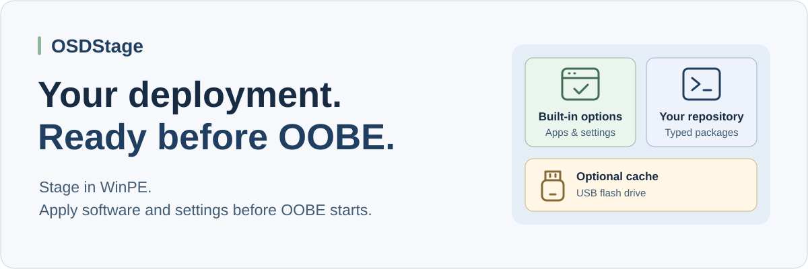
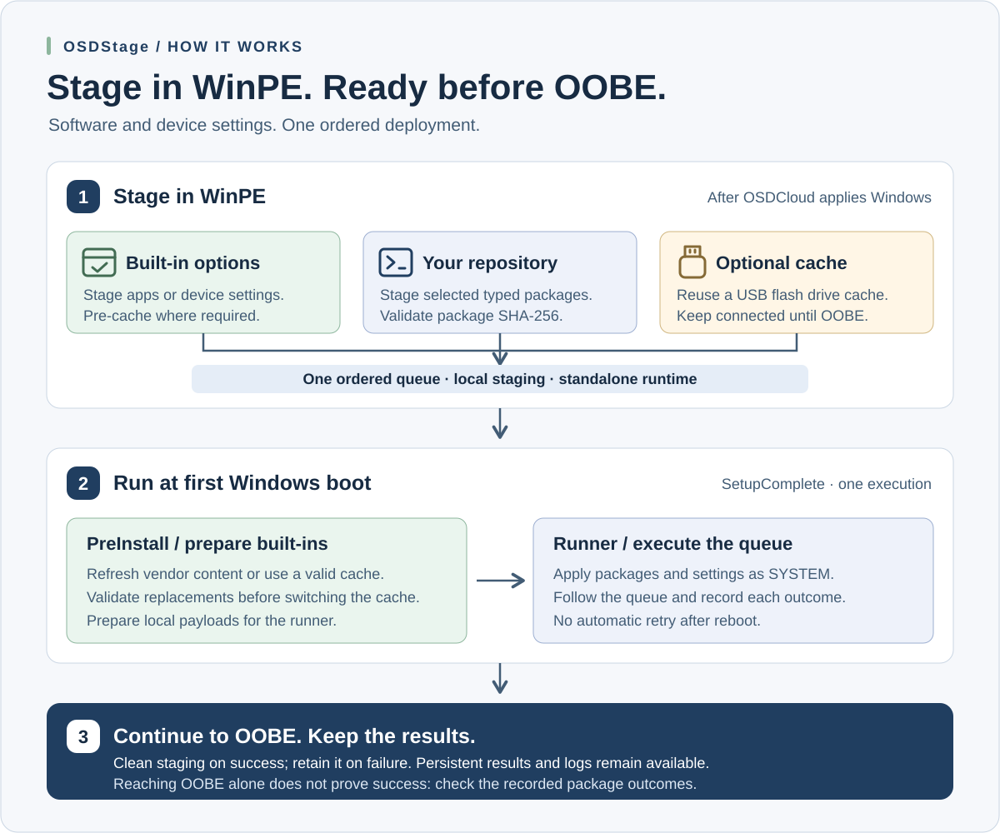

# OSDStage

> **Release candidate: 1.0.0-rc3.** Install with `-AllowPrerelease`. Documentation on `main` also covers merged changes that are not yet in the Gallery; check [release availability](docs/release-status.md). Repository and package manifests use schema 2.



[](https://www.powershellgallery.com/packages/OSDStage)
[](https://www.powershellgallery.com/packages/OSDStage)
[](https://github.com/roryvossepoel/OSDStage/actions/workflows/ci.yml)
[](#install-from-powershell-gallery)
[](LICENSE)

Stage software and device configuration in WinPE **after OSDCloud has applied Windows**. OSDStage applies the selected packages and settings in order during the first Windows boot, just before OOBE starts. Use built-in integrations, your own repository packages, or both.

- **Start with a few commands.** Built-in apps need no repository or custom installer wrapper.
- **Reuse your downloads.** An optional USB cache serves multiple devices; validated replacements keep it current.
- **Bring your own packages.** Apps, scripts, fonts, certificates and drivers share one ordered queue and package integrity checks.
- **Opt in to Windows inbox cleanup.** A bundled script can remove explicitly selected provisioned apps before OOBE, without an app repository.
- **Leave a clean deployment.** Successful runs remove temporary staging while keeping logs and results. No module installation is required in the deployed Windows system.

[Get started](#quick-start) · [Built-in apps](docs/built-in-apps.md) · [USB preparation](Examples/Prepare-UsbCache.md) · [Repository packages](docs/repository.md) · [Documentation](docs/README.md)

## Install from PowerShell Gallery

Run in PowerShell on your Windows preparation machine, or in online WinPE with PowerShellGet available.

```powershell
Install-Module OSDStage -Repository PSGallery -AllowPrerelease -Force -ErrorAction Stop
Import-Module OSDStage -Force
```

`-SkipPublisherCheck` bypasses PowerShellGet's module publisher comparison; it does not disable OSDStage installer signature checks.

For WinPE without Gallery access, [save the module to your USB flash drive](Examples/Prepare-UsbCache.md) first. Installation uses your PowerShellGet defaults; use an elevated session if your installation scope requires it.

## Quick start

**Run this complete example in online WinPE, after OSDCloud has applied Windows and before the first reboot.** It stages three apps for the target PC:

```powershell
Install-Module OSDStage -Repository PSGallery -AllowPrerelease -Force -ErrorAction Stop
Import-Module OSDStage -Force

Add-OSDStageMicrosoft365Apps -Channel MonthlyEnterprise -Language en-us
Add-OSDStageAdobeAcrobatUnified
Add-OSDStageGoogleChromeEnterprise
```

That's the queue: **Microsoft 365 Apps → Adobe Acrobat Unified → Google Chrome Enterprise**. These commands use x64 by default. Change the Office channel and language to suit your deployment; use the same settings when preparing its cache.

OSDStage discovers the offline Windows installation, prepares SetupComplete and removes temporary staging after success by default. Apps are installed during the first Windows boot, not in WinPE. Continue your normal deployment reboot after staging completes without errors.

**The three commands above work with or without a USB flash drive:**

- **With an OSDCloud-labeled USB flash drive:** matching cached content is staged as fallback. SetupComplete checks for updates and can refresh the cache. Leave the USB flash drive connected until OOBE appears.
- **Without a USB flash drive:** SetupComplete downloads built-in content directly to local staging. Keep the PC online until OOBE appears.

**From RC2:** Company Portal and CMTrace Open also support online acquisition during SetupComplete. See [release availability](docs/release-status.md) when upgrading from RC1. A detected OSDCloud USB cache is checked and refreshed automatically; without USB, content is acquired on the Windows disk. Prepare verified content in advance only when you need a fully offline deployment.

Keep networking available for either online route. No module copy on the USB flash drive is needed when loading from the Gallery. For a fully disconnected deployment, [prepare matching content and save the module first](Examples/WinPE-Offline.md).

For an optional preflight check before rebooting, run `Test-OSDStageDeployment -ThrowOnFailure`. You can also inspect the queue in the Viewer:

```powershell
Show-OSDStageUI -Offline
```

The Viewer is read-only. Here, `-Offline` skips online repository discovery; it does not change the deployment's network behavior. Close the Viewer before rebooting.

## Built-in apps

The optional Windows Inbox Cleanup script is staged with `Add-OSDStageWindowsInboxCleanup -Preset Tested13` or `-Remove @('Microsoft.BingWeather')`. It is never run implicitly. [Options and validation](docs/windows-inbox-cleanup.md#windows-inbox-cleanup).

| App | Stage in WinPE |
| --- | --- |
| Microsoft 365 Apps | `Add-OSDStageMicrosoft365Apps` |
| Microsoft Teams | `Add-OSDStageMicrosoftTeams` |
| Microsoft Company Portal | `Add-OSDStageMicrosoftCompanyPortal` |
| CMTrace Open | `Add-OSDStageCMTraceOpen` |
| Adobe Acrobat Unified | `Add-OSDStageAdobeAcrobatUnified` |
| Google Chrome Enterprise | `Add-OSDStageGoogleChromeEnterprise` |
| Mozilla Firefox Enterprise | `Add-OSDStageMozillaFirefoxEnterprise` |
| Cisco Webex | `Add-OSDStageCiscoWebex` |
| Zoom Workplace | `Add-OSDStageZoomWorkplace` |
| 7Zip | `Add-OSDStage7Zip` |
| Visual Studio Code | `Add-OSDStageVisualStudioCode` |
| Visual C++ v14 (x86 or x64) | `Add-OSDStageVisualCRedist -Architecture x64` |
| .NET Runtime / Desktop Runtime | `Add-OSDStageDotNetRuntime -Architecture x64` |

Installers come directly from their vendors. Supported architectures and options differ by app; see the [built-in guide](docs/built-in-apps.md) for Office configuration, Firefox channels and other settings. OSDStage does not bundle vendor installers or provide product licenses.

## Software and settings. One queue.

Repository package types are `App`, `Script`, `Font`, `Certificate` and `Driver`. All use `Package.zip` and SHA-256 validation. App and Script packages run `Package/Install.ps1`; Font, Certificate and Driver packages use the module's type-specific handlers. Add them alongside built-ins in the order you want them processed.

| Configure | Guide |
| --- | --- |
| Fonts, machine CA certificates and driver packages | [Repository packages](docs/repository.md), [certificates](docs/certificate-staging.md), [drivers](docs/driver-packages.md) |
| Registry, machine variables and services | [Registry](docs/registry-staging.md), [variables](docs/environment-variables.md), [services](docs/services.md) |
| Files and directories | [Create, copy and remove](docs/file-system.md) |
| Wi-Fi profiles | [XML and parameter input](docs/wifi-staging.md) |
| Optional features, FoDs and inbox app removal | [Feature scope](docs/feature-status.md), [capabilities](docs/windows-capabilities.md), [inbox cleanup](docs/windows-inbox-cleanup.md#windows-inbox-cleanup) |
| Initial app associations and Start/taskbar pins | [Associations](docs/default-associations.md), [pins](docs/desktop-settings.md) |

Configure your own catalog URL, then stage a package using its actual repository ID:

```powershell
Set-OSDStageConfiguration -CatalogUri 'https://packages.example.com/osdstage/catalog.json'
Add-OSDStage -Name 'YourPackageId'
```

The URL and ID above are placeholders. No hosted sample repository or built-in script collection is included. Scripts run as **SYSTEM**, must be unattended and must not restart Windows. See [repository packaging](docs/repository.md) and the [package example](Examples/README.md#build-a-repository-package).

## How it works



| When | What OSDStage does |
| --- | --- |
| Optional preparation on a Windows PC | Save the module and download reusable content to an OSDCloud USB cache. |
| WinPE, after applying Windows | Stage selected repository packages, built-in configuration and available cached content. Create one ordered queue and the standalone runtime. |
| First Windows boot, during SetupComplete | PreInstall prepares built-in content. Runner installs apps and executes scripts from local staging in queue order. |
| After processing | Keep per-package results and logs. Clean temporary staging on success and let the normal Windows setup flow continue. |

SetupComplete runs **once**. OSDStage creates no automatic retry task, service or RunOnce entry. Ordinary package failures are recorded while independent entries continue; manifest, repository-integrity and supported-publisher trust failures stop processing. A failed or skipped entry retains staging for investigation. Reaching OOBE alone does not prove that every package succeeded.

## A reusable cache you can inspect

The optional cache lives under `\OSDStage` on the volume labeled `OSDCloud`. Prepare it on a Windows PC, then reuse it across deployments. Built-in updates validate a complete replacement before switching the active directory; repository updates verify package hashes before committing changes.

Check existing cache health without changing it:

```powershell
Get-OSDStageCacheHealth -Offline
```

Use the [USB preparation guide](Examples/Prepare-UsbCache.md) to get started, [cache reconciliation](docs/repository.md#cache-health-and-reconciliation) to retire repository content, and [cache generation recovery](docs/architecture.md#cache-generation-recovery) for interrupted updates. Only one process should write to a cache at a time.

## Inspect before deployment. Keep the results afterward.

The **Windows Viewer** (`Show-OSDStageUI`) shows the staged queue, available packages, cache and logs. The **Package Type** column identifies the selected package type. Use it in WinPE to review staging or on a preparation machine to inspect the cache. See the [Viewer guide](docs/viewer.md).

The separate **web catalog viewer** browses built-in metadata and a user-supplied repository URL. It cannot inspect a local USB cache or target staging. See [the viewer distinction](docs/viewer.md#two-different-viewers).

The deployed Windows system keeps its results without needing the module or Viewer:

| File | Purpose |
| --- | --- |
| `%ProgramData%\OSDStage\Results\Latest.json` | Overall result and individual package outcomes |
| `%ProgramData%\OSDStage\Logs\Runtime.log` | Detailed acquisition, execution and cleanup events |

See [results and troubleshooting](docs/getting-started.md#5-check-the-outcome) for inspection commands. Recorded hardware tests and timing measurements are in the [validation matrix](docs/testing.md) and [performance notes](docs/performance.md).

## Go further

- [Getting started](docs/getting-started.md): preparation, staging and results.
- [Online](Examples/WinPE-Online.md) and [offline](Examples/WinPE-Offline.md) workflows: complete examples for the target PC.
- [Security and publisher checks](docs/built-in-acquisition.md#authenticode-and-publisher-policy-0340): exactly what is checked and the requirements for offline trust.
- [Runtime and cleanup](docs/runtime.md): execution order, failures and retained diagnostics.
- [Maintenance checks](docs/maintenance.md): read-only USB, release and saved-result inspection on the preparation PC.
- [Contributing](CONTRIBUTING.md): improvements and built-in requests.
- [Changelog](CHANGELOG.md): release history.

Reading a packaged copy? The full guides and images are in the [online documentation](https://github.com/roryvossepoel/OSDStage/blob/main/docs/README.md).

OSDStage is licensed under the [MIT License](LICENSE).
