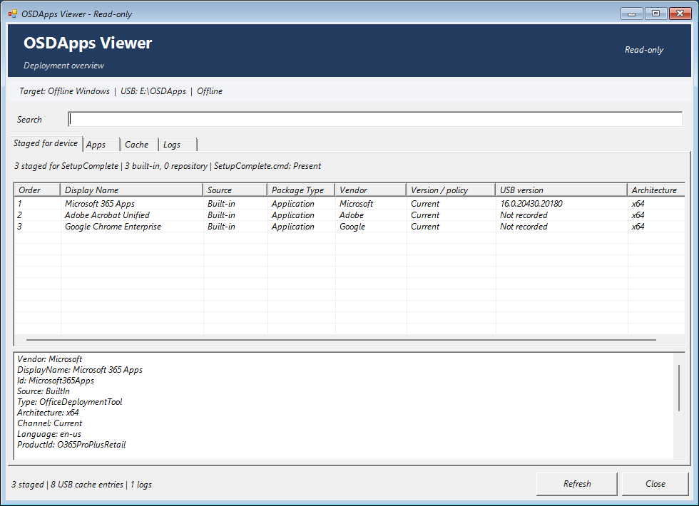

# OSDApps

[](https://www.powershellgallery.com/packages/OSDApps)
[](https://www.powershellgallery.com/packages/OSDApps)
[](https://github.com/roryvossepoel/OSDApps/actions/workflows/ci.yml)
[](#install-from-powershell-gallery)
[](LICENSE)

**Deploy Windows with the apps and scripts it needs, before the first sign-in.**

OSDApps brings application and PowerShell script deployment to **OSDCloud v2**. Choose your packages in WinPE and let SetupComplete run them in order before OOBE continues. Use ready-made vendor integrations, your own repository packages, or both.

- **Start with a few commands.** Built-in apps need no repository or custom installer wrapper.
- **Reuse your downloads.** An optional USB cache serves multiple devices; validated replacements keep it current.
- **Bring your own apps and scripts.** Both share one ordered queue and the same package integrity checks.
- **Leave a clean deployment.** Successful runs remove temporary staging while keeping logs and results. No module installation is required in the deployed Windows system.

[Get started](#quick-start) · [Built-in apps](docs/built-in-apps.md) · [USB preparation](Examples/Prepare-UsbCache.md) · [Apps and scripts](docs/repository.md) · [Documentation](docs/README.md)

## Install from PowerShell Gallery

Run in PowerShell on your Windows preparation machine, or in online WinPE with PowerShellGet available:

```powershell
Install-Module OSDApps -Force -SkipPublisherCheck
Import-Module OSDApps -Force
```

`-SkipPublisherCheck` bypasses PowerShellGet's module publisher comparison; it does not disable OSDApps installer signature checks.

For WinPE without Gallery access, [save the module to your USB stick](Examples/Prepare-UsbCache.md) first. Installation uses your PowerShellGet defaults; use an elevated session if your installation scope requires it.

## Quick start

**Run this complete example in online WinPE, after OSDCloud has applied Windows and before the first reboot.** It stages three apps for the target PC:

```powershell
$ErrorActionPreference = 'Stop'

Install-Module OSDApps -Force -SkipPublisherCheck
Import-Module OSDApps -Force

Add-OSDAppMicrosoft365Apps -Channel MonthlyEnterprise -Language en-us
Add-OSDAppAdobeAcrobatUnified
Add-OSDAppGoogleChromeEnterprise

Test-OSDAppDeployment -ThrowOnFailure
```

That's the queue: **Microsoft 365 Apps → Adobe Acrobat Unified → Google Chrome Enterprise**. These commands use x64 by default. Change the Office channel and language to suit your deployment; use the same settings when preparing its cache.

OSDApps discovers the offline Windows installation, prepares SetupComplete and removes temporary staging after success by default. Apps are installed during the first Windows boot, not in WinPE. Continue your normal deployment reboot only after the preflight check passes.

**The same commands work with or without a cache USB:**

- **With an OSDCloud-labeled stick:** matching cached content is staged as fallback. SetupComplete checks for updates and can refresh the cache. Leave the stick connected until OOBE appears.
- **Without a cache stick:** SetupComplete downloads built-in content directly to local staging. Keep the PC online until OOBE appears.

Keep networking available for either online route. No module copy on the stick is needed when loading from the Gallery. For a fully disconnected deployment, [prepare matching content and save the module first](Examples/WinPE-Offline.md).

Optionally inspect the queue before continuing your normal reboot:

```powershell
Show-OSDAppUI -Offline
```

The Viewer is read-only. Here, `-Offline` skips online repository discovery; it does not change the deployment's network behavior. Close the Viewer before rebooting.

## Built-in apps

| Application | Stage in WinPE |
| --- | --- |
| Microsoft 365 Apps | `Add-OSDAppMicrosoft365Apps` |
| Microsoft Teams | `Add-OSDAppMicrosoftTeams` |
| Adobe Acrobat Unified | `Add-OSDAppAdobeAcrobatUnified` |
| Google Chrome Enterprise | `Add-OSDAppGoogleChromeEnterprise` |
| Mozilla Firefox Enterprise | `Add-OSDAppMozillaFirefoxEnterprise` |
| Cisco Webex | `Add-OSDAppCiscoWebex` |

Installers come directly from their vendors. Supported architectures and options differ by application; see the [built-in guide](docs/built-in-apps.md) for Office configuration, Firefox channels and other settings. OSDApps does not bundle vendor installers or provide product licenses.

## Your apps. Your scripts. One queue.

Use a repository for applications you package yourself and PowerShell scripts that configure the machine. Classify a package as `Application` or `Script`; both use the same `Package.zip` layout, SHA-256 validation and `Add-OSDApp` command. Add them alongside built-ins in the order you want them to run.

Configure your own catalog URL, then stage a package using its actual repository ID:

```powershell
Set-OSDAppConfiguration -CatalogUri 'https://packages.example.com/osdapps/catalog.json'
Add-OSDApp -Name 'YourPackageId'
```

The URL and ID above are placeholders. No hosted sample repository or built-in script collection is included. Scripts run as **SYSTEM**, must be unattended and must not restart Windows. See [repository packaging](docs/repository.md) and the [package example](Examples/README.md#build-a-repository-package).

## How it works


| When | What OSDApps does |
| --- | --- |
| Optional preparation on a Windows PC | Save the module and download reusable content to an OSDCloud USB cache. |
| WinPE, after applying Windows | Stage selected repository packages, built-in configuration and available cached content. Create one ordered queue and the standalone runtime. |
| First Windows boot, during SetupComplete | PreInstall prepares built-in content. Runner installs apps and executes scripts from local staging in queue order. |
| After processing | Keep per-package results and logs. Clean temporary staging on success and let the normal Windows setup flow continue. |

SetupComplete runs **once**. OSDApps creates no automatic retry task, service or RunOnce entry. Ordinary package failures are recorded while independent entries continue; manifest, repository-integrity and supported-publisher trust failures stop processing. A failed or skipped entry retains staging for investigation. Reaching OOBE alone does not prove that every package succeeded.

## A reusable cache you can inspect

The optional cache lives under `\OSDApps` on the volume labeled `OSDCloud`. Prepare it on a Windows PC, then reuse it across deployments. Built-in updates validate a complete replacement before switching the active directory; repository updates verify package hashes before committing changes.

Check existing cache health without changing it:

```powershell
Get-OSDAppCacheHealth -Offline
```

Use the [USB preparation guide](Examples/Prepare-UsbCache.md) to get started, [cache reconciliation](docs/repository.md#cache-health-and-reconciliation) to retire repository content, and [cache generation recovery](docs/architecture.md#cache-generation-recovery) for interrupted updates. Only one process should write to a cache at a time.

## Inspect before deployment. Keep the results afterward.

**OSDApps Viewer** shows the staged queue, available packages, cache and logs. The **Package Type** column distinguishes `Application` from `Script` in the Staged for device, Apps and Cache tabs. Use it in WinPE to review staging or on a preparation machine to inspect the cache. See the [Viewer guide](docs/viewer.md).



*A real WinPE staging session. The detail pane shows the selected Office configuration; channel, language and cached versions reflect that session. [See the Apps and Cache views](docs/viewer.md#screenshots-from-winpe).*

The deployed Windows system keeps its results without needing the module or Viewer:

| File | Purpose |
| --- | --- |
| `%ProgramData%\OSDApps\Results\Latest.json` | Overall result and individual package outcomes |
| `%ProgramData%\OSDApps\Logs\Runtime.log` | Detailed acquisition, execution and cleanup events |

See [results and troubleshooting](docs/getting-started.md#5-check-the-outcome) for inspection commands. Recorded hardware tests and timing measurements are in the [validation matrix](docs/testing.md) and [performance notes](docs/performance.md).

## Go further

- [Getting started](docs/getting-started.md): preparation, staging and results.
- [Online](Examples/WinPE-Online.md) and [offline](Examples/WinPE-Offline.md) workflows: complete examples for the target PC.
- [Security and publisher checks](docs/built-in-apps.md#authenticode-and-publisher-policy-0340): exactly what is checked and the requirements for offline trust.
- [Runtime and cleanup](docs/runtime.md): execution order, failures and retained diagnostics.
- [Maintenance checks](docs/maintenance.md): read-only USB, release and saved-result inspection on the preparation PC.
- [Contributing](CONTRIBUTING.md): improvements and built-in requests.
- [Changelog](CHANGELOG.md): release history.

Reading a packaged copy? The full guides and images are in the [online documentation](https://github.com/roryvossepoel/OSDApps/blob/main/docs/README.md).

OSDApps is licensed under the [MIT License](LICENSE).
