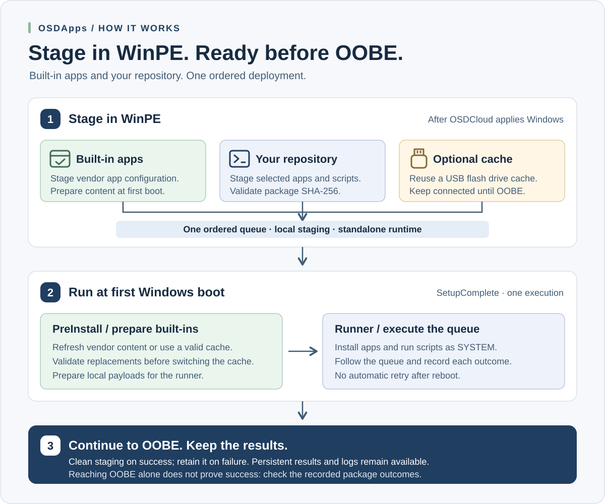
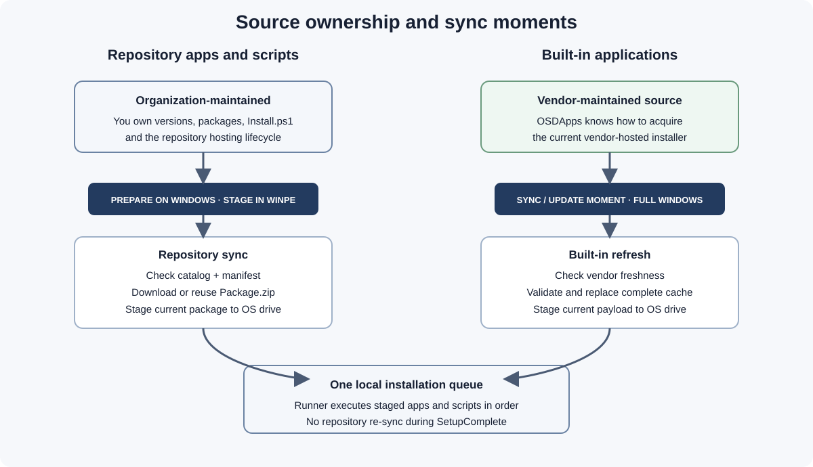

# Architecture

[Documentation](README.md) · [Getting started](getting-started.md) · [Runtime](runtime.md)

OSDApps separates content ownership, acquisition, device staging, installation and inspection. The CLI writes deployment state; the Viewer reads it. SetupComplete runs independently of the module.



## End-to-end flow

```text
Full Windows preparation (optional)
    save module and prepare reusable USB content

WinPE after OSDCloud applies Windows
    synchronize selected repository packages when online
    stage built-in intent and available fallback content
    write one ordered device queue and standalone runtime

First Windows boot / SetupComplete
    PreInstall prepares built-ins and enforces applicable installer trust checks
    Runner validates all selected repository hashes before installer execution
    each independent app is attempted once; ordinary app failures do not block the rest
    write persistent result; apply cleanup policy; retain logs

OOBE / Autopilot continues
```

The Viewer can inspect an existing Windows target and cache in full Windows or supported WinPE. It does not perform any of the acquisition, staging, installation or cleanup steps above.

## Two source models

### Repository applications

A repository is organization-managed static content: `catalog.json`, per-app manifests and package archives. During WinPE staging the module resolves a compatible variant, downloads or reuses its `Package.zip`, checks the manifest SHA-256 and copies it to local device staging.

Runner checks every available selected staged archive before starting the first installer, then extracts it for `Package/Install.ps1` execution. A hash mismatch is a queue-blocking trust failure. Runner does not contact the repository to refresh packages during SetupComplete.

Full-Windows `Sync-OSDAppRepository` can also prepare media ahead of deployment. Repository variants are selected for the synchronization host's architecture; preparation on a different architecture needs explicit care. Repository content, licensing and hosting remain the repository owner's responsibility.

`Get-OSDAppCacheHealth` compares physical cache content, local metadata and an
optional desired catalog without changing files. Explicit
`Sync-OSDAppRepository -Prune` reconciles the complete host-compatible catalog
transactionally; normal selective synchronization remains merge-only.

### Built-in applications

Built-ins are vendor-native integrations maintained by OSDApps. The module does not ship their installer payloads.

WinPE stages deployment intent and copies matching existing cache content as fallback when available. Full-Windows Sync commands or standalone PreInstall perform acquisition/refresh. Microsoft 365 Apps uses the Office Deployment Tool; Teams, Adobe, Chrome, Firefox and Webex use their integrated vendor acquisition paths.

Supported installer files are checked for Windows Authenticode trust and the expected publisher organization. This covers Office `setup.exe`, Teams `teamsbootstrapper.exe` and Chrome/Firefox/Webex MSI files, not every nested payload. See the [publisher policy](built-in-apps.md#authenticode-and-publisher-policy-0340).

## Why Office refreshes in full Windows

OSDApps does not treat the Office Deployment Tool as a WinPE acquisition mechanism. It uses the full-Windows runtime for Office synchronization. The same phase boundary is used for all built-ins; public built-in Sync commands are not the WinPE staging interface.

An organization can instead supply Office as a repository package when it needs to own the package/version. Repository acquisition then happens in WinPE, but installation still runs in Windows.

## Optional OSDCloud USB cache

The CLI identifies a visible volume by `CacheVolumeLabel` (default `OSDCloud`), not a fixed drive letter. Its cache root is `\OSDApps`.

| Condition | Acquisition path |
| --- | --- |
| USB + online | Stage available cache as fallback, check vendor freshness and refresh where needed. |
| USB + offline | Use matching, complete local content staged from the cache, subject to applicable trust/hash checks. |
| No USB + online | Repository staging can use a temporary cache on the offline Windows disk; built-ins can be acquired directly to the local runtime after boot. |
| No USB + offline | Requires sufficient acceptable content already staged on the device. Without it, acquisition/installation cannot succeed. |

The cache changes where content is acquired and reused. Runner consumes local staging; it does not execute installers directly from the USB cache. Keep media attached while the deployment is using it.



## Runtime locations

| Location | Contents |
| --- | --- |
| `<cache volume>:\OSDApps` | Reusable repository/built-in cache and cache-operation logs |
| `<Windows target>\Windows\Temp\OSDApps` | Per-device manifest, PreInstall/Runner, staged packages and Work |
| `%ProgramData%\OSDApps\Logs\Runtime.log` | Default persistent PreInstall/Runner log in deployed Windows |
| `%ProgramData%\OSDApps\Results\Latest.json` | Default atomic final deployment result and per-app outcomes |

Typical local staging contains `DeviceManifest.json`, `Invoke-OSDAppPreInstall.ps1`, `Invoke-OSDAppRunner.ps1`, `Packages`, `BuiltIn` and `Work`.

`CleanupMode OnSuccess` schedules removal of temporary device source only after every selected application succeeded; `Never` retains it. A failed or skipped application retains source for investigation. The persistent log, result and reusable USB cache are separate from that staging directory.

SetupComplete is a one-shot Windows Setup phase. OSDApps deliberately creates no scheduled task, RunOnce value, service or other retry persistence. PreInstall and Runner therefore isolate ordinary app-local failures and continue independent entries during that one execution. Manifest, hash and supported-publisher trust failures remain blocking safety boundaries.

## Source resolution rules

For built-ins, the deployment first identifies the optional cache and available local fallback, then attempts freshness/acquisition when network availability permits. Content must be locally available and pass the checks applicable to its format before installation.

A refresh failure is not automatically fatal if an acceptable staged fallback exists. Without a usable fallback, that built-in is recorded as failed and its installer is skipped while independent entries can continue. Conversely, a complete-looking fallback is not automatically acceptable: a supported MSI/EXE signature or publisher failure stops deployment. `GetIsNetworkAvailable()` reports interface availability, not verified access to every vendor endpoint.

The explicit log events distinguish cache discovery, refresh skipped, refresh failed with fallback, signature verification and installer results. See [Runtime logging](runtime.md#logging).

## Metadata model

| File | Role |
| --- | --- |
| `catalog.json` | Repository index, including optional retired aliases mapped to canonical IDs |
| `Apps/<Id>/<Version>/<Architecture>/manifest.json` | Per-repository-package metadata and archive hash |
| `CacheCatalog.json` | Local repository-cache snapshot |
| `CacheInfo.json` | Per-built-in cache metadata |
| `DeviceManifest.json` | Selected Windows target's ordered `Apps` queue and runtime settings |
| `metadata/builtins.json` | Public built-in definitions for discovery and external consumers; not the organization's package catalog |

Optional repository Vendor metadata is descriptive. It is not a signing certificate, a signature verification result or an authorization decision.

## Device manifest

The manifest has a stable per-staging `DeploymentId` and one ordered `Apps` array containing `Source=BuiltIn` or `Source=Repository` entries. PreInstall filters the built-ins for preparation; Runner processes the full array from top to bottom and uses the identity to correlate phase results.

Adding a new Id appends it. Re-adding an existing Id replaces its entry and moves it to the end, rather than creating a duplicate. Viewer sorting changes only the screen order; it never writes the manifest.

`Set-OSDAppConfiguration` is session-scoped. Add commands capture runtime settings in the manifest so SetupComplete does not need the module or the original PowerShell session.

For exact package fields, see [Repository applications](repository.md), [Built-in applications](built-in-apps.md) and the [public metadata contract](public-metadata.md). For proven scenarios and remaining limitations, see [Validation matrix](testing.md).
