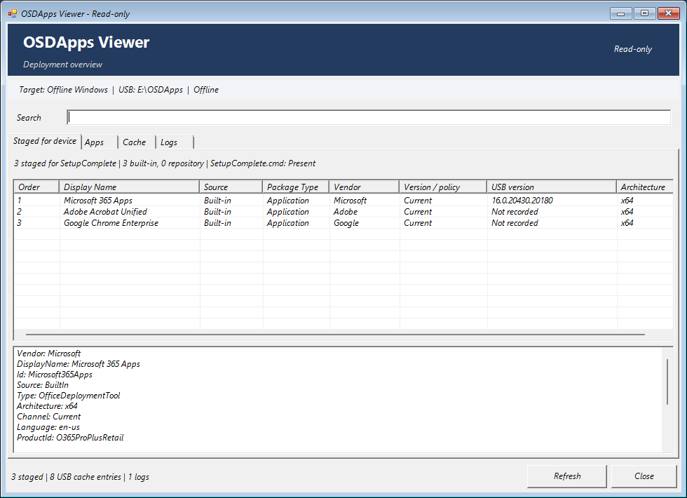
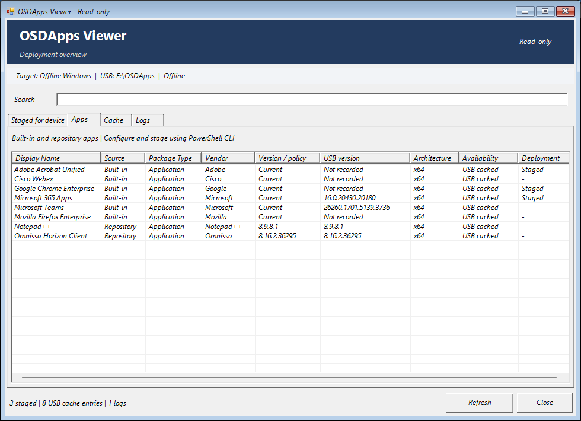
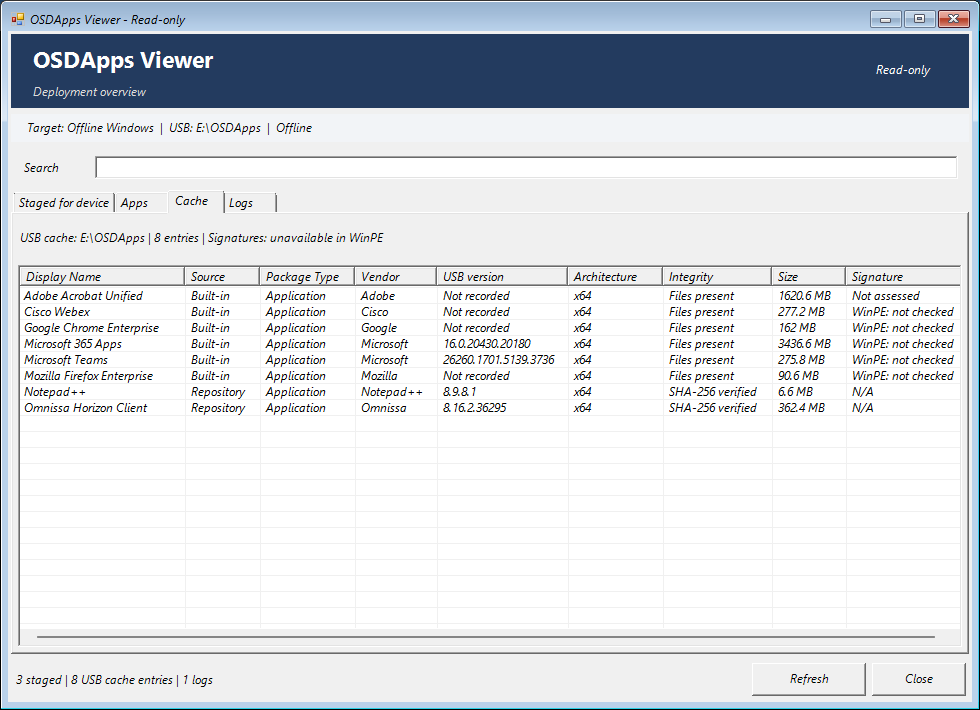

# Historical OSDApps Viewer screenshots

These are original, unmodified WinPE captures from before the OSDStage rename.
They show the old OSDApps title, cache paths and the package selection from that
session. They are historical evidence, not current OSDStage UI documentation.
The staged queue is not proof of successful installation.

## Staged queue

## Available packages

## USB cache

See [the current viewer guide](../viewer.md) for supported usage and the distinction
between the Windows inspector and the separate web catalog viewer.
