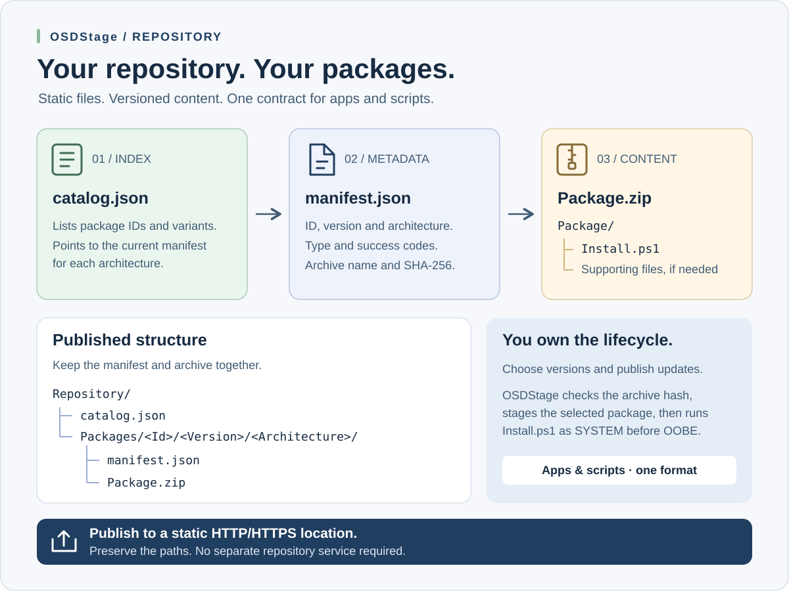

# Repository applications




OSD Apps repositories are static content. A separate repository service or PowerShell module is not required.

OSDApps defines the repository contract, provides examples, and includes optional authoring helpers to create and validate the required folders and JSON.

Application names used in examples, such as `OmnissaHorizonClient` and `NotepadPlusPlus`, represent packages from an organization's own repository. They are not built-in OSDApps applications and are not distributed or maintained by this project.

Repository synchronization can be used on a **full-Windows preparation machine** to pre-cache media or in **WinPE** while staging a target. OSDApps resolves the requested repository package, refreshes or reuses the optional OSDCloud USB cache, validates the package, and stages it into the offline Windows installation before the first boot. SetupComplete then installs the staged local package; repository content is not refreshed again in full Windows.

## Repository layout

```text
Repository/
├── catalog.json
└── Apps/
    └── <AppId>/
        └── <Version>/
            └── <Architecture>/
                ├── manifest.json
                └── Package.zip
```

Supported repository architectures:

```text
x64
arm64
any
```

## Root catalog

`catalog.json` is an index. It points to the current package manifest for each application and architecture.

Example:

```json
{
  "SchemaVersion": 1,
  "GeneratedAt": "2026-10-06T00:00:00Z",
  "Applications": [
    {
      "Id": "ExampleApp",
      "Aliases": [
        "RetiredExampleApp"
      ],
      "Packages": [
        {
          "Architecture": "x64",
          "Manifest": "Apps/ExampleApp/1.0.0/x64/manifest.json"
        }
      ]
    }
  ]
}
```

`Id` is the canonical identity. Optional `Aliases` are retired IDs that now
resolve to that canonical application. IDs and aliases are compared
case-insensitively, must be safe directory names, and cannot collide with any
other canonical ID or alias. Aliases are identity metadata; they do not create
another package or cache copy.

## Package manifest

Each deployable package keeps its metadata directly beside `Package.zip`.

```json
{
  "SchemaVersion": 1,
  "Id": "ExampleApp",
  "DisplayName": "Example App",
  "Vendor": "Example Software",
  "Version": "1.0.0",
  "Architecture": "x64",
  "PackageType": "Application",
  "SuccessCodes": [
    0,
    3010
  ],
  "Archive": {
    "FileName": "Package.zip",
    "Sha256": "<SHA256>"
  }
}
```

The `Vendor` property is optional descriptive package metadata. It is set in
each application's `manifest.json`, alongside `DisplayName`. If omitted,
existing repositories remain fully compatible and the GUI shows a dash for an
unknown vendor. The value is carried into USB `CacheCatalog.json` and the
staged `DeviceManifest.json`; the GUI remains read-only.

You can add or correct `Vendor` in an existing published package manifest
without repackaging `Package.zip` or changing its SHA-256 hash. Publish the
updated manifest and run `Sync-OSDAppRepository -Name <Id>` on the Windows
development machine (or normal WinPE repository sync) to refresh its cached
metadata. The existing cache archive is reused when its SHA-256 still matches.
Previously staged `DeviceManifest.json` files are not silently rewritten.

`PackageType` is optional classification metadata with two supported values:
`Application` and `Script`. When it is absent, OSDApps uses `Application` for
backward compatibility. Both types use the same `Package/Install.ps1` entry
point, SHA-256 checks, cache and staging paths, ordered SetupComplete queue,
timeouts, success codes and failure handling. The value does not enable a
different or less trusted execution path.

When an existing package variant is republished, omitting `-PackageType`
preserves its current classification. A newly published package defaults to
`Application`.

Use `Script` for machine-context configuration, debloat or remediation logic
that must run once during SetupComplete. Such scripts run as SYSTEM, must not
restart or shut down Windows, and should not target `HKCU`: no normal end-user
profile is active in this phase. OSDApps records the result but does not provide
automatic rollback for changes made by a script.

The package URL is derived from the manifest location. A separate `SourcePath` property is not used.

## Package archive contract

Authoring source:

```text
ExampleApp/
├── Install.ps1
└── <payload>
```

Published archive:

```text
Package.zip
└── Package/
    ├── Install.ps1
    └── <payload>
```

`Install.ps1` must be unattended and suitable for execution during SetupComplete. The runner starts it with the extracted `Package` directory as its working directory.

## Deployment lifecycle

```text
WinPE
→ resolve catalog.json
→ resolve requested app manifest
→ synchronize/reuse OSDCloud USB cache
→ validate SHA-256
→ stage Package.zip to offline Windows

First boot / SetupComplete
→ validate staged package again
→ extract Package.zip
→ run Package/Install.ps1
```

This makes repository applications deterministic at first boot: the package that was selected and cached in WinPE is the package that SetupComplete installs.

## Preparing content for another architecture

From 0.43.0, choose the repository target explicitly when the preparation machine and target differ:

```powershell
Sync-OSDAppRepository -Name 'YourPackageId' -Architecture x64
Get-OSDAppCacheHealth -Architecture x64
```

Both commands use the host architecture when `-Architecture` is omitted. Supported target values are `x64` and `arm64`; an exact catalog variant is preferred over `any`. `any` describes a neutral package, not a target architecture. If no compatible variant exists, synchronization fails before changing the cache. Offline health inspection checks locally recorded content and does not select a desired variant.

The existing layout stores one variant per repository Id. Changing target architecture for that Id replaces its cached content through the same transaction and hash checks. It does not retain parallel x64/ARM64 versions. Selective sync preserves unrelated Ids; `-Prune` still reconciles the complete catalog, with explicit pins retaining valid exceptions. Use the same target for preview and execution:

```powershell
Get-OSDAppCacheHealth -Architecture x64
Sync-OSDAppRepository -Architecture x64 -Prune -WhatIf
# After reviewing the intended target and removals:
Sync-OSDAppRepository -Architecture x64 -Prune -Confirm
```

This is a preparation choice, not a persisted deployment setting. WinPE staging still resolves repository variants for its host architecture. Built-in synchronizers retain their own architecture options. Use separate media if both variants of the same Id must remain cached.

## Cache health and reconciliation

Inspecting health is read-only. With a desired catalog, OSDApps compares the
physical cache, `CacheCatalog.json`, canonical IDs and aliases:

```powershell
$Health = Get-OSDAppCacheHealth -CatalogPath C:\OSDApps\Repository\catalog.json
$Health | Select-Object Healthy, CatalogError, CacheCatalogError, ActiveCount, PinnedCount, ObsoleteCount, OrphanedCount, RenamedCount, IncompleteCount, CorruptCount, RemovableSizeMB
$Health.Entries |
    Where-Object Action -ne 'None' |
    Select-Object Id, CanonicalId, State, Integrity, Action, Reason, SizeMB
```

Use `-CatalogUri` for an explicit published catalog. With the session's
configured `CatalogUri`, omit both catalog arguments. To verify only the local
cache without a repository request:

```powershell
Get-OSDAppCacheHealth -Offline
```

A valid locally cataloged package remains `Active` during that offline check;
OSDApps does not call it obsolete merely because desired state was not queried.
The health states are:

| State | Meaning |
| --- | --- |
| `Active` | Canonical desired content is current, or locally recorded content passes SHA-256 during an offline-only inspection. |
| `Pinned` | Valid repository content is intentionally retained outside desired state. |
| `Obsolete` | A cached canonical ID or version no longer matches desired state. |
| `Orphaned` | A physical folder is not represented by usable cache metadata. |
| `Renamed` | A retired alias folder exists for a canonical ID. |
| `Incomplete` | Required content is missing. |
| `Corrupt` | Metadata is invalid/ambiguous or a repository SHA-256 fails. |

An unfinished directory under `.staging` is reported separately with
`Source=Transaction` and `Action=Review`. Recovery data is never removed by a
health inspection or by an unrelated prune operation.

Normal selective synchronization remains non-destructive and continues to
merge entries. When a current alias names an older cached canonical ID, its
conflicting metadata is retired so alias resolution stays unambiguous, while
the old package folder remains untouched. Cleanup is explicit and always uses
the complete catalog:

```powershell
# Configured CatalogUri and intended OSDCloud cache volume required.
Sync-OSDAppRepository -Prune -WhatIf
Sync-OSDAppRepository -Prune -Confirm
```

`-Prune` cannot be combined with `-Name`. OSDApps first resolves the complete
host-compatible plan and downloads and SHA-256-validates every replacement.
Stale folders are moved into the same-volume transaction backup, new packages
are promoted, and `CacheCatalog.json` is the commit point. A failure before
commit restores the previous catalog and folders.

An exceptional package can be retained by canonical ID only when its existing
archive is still valid:

```powershell
Sync-OSDAppRepository -Prune -PinnedId LegacyApp -WhatIf
Sync-OSDAppRepository -Prune -PinnedId LegacyApp -Confirm
```

Unknown, missing, corrupt and alias pins are rejected. Repository pruning does
not clear built-in caches, device staging or the source repository. A successful
`Sync-OSDAppMicrosoftTeams` and standalone PreInstall separately remove the
retired `BuiltIn\Teams` folder only after the canonical
`BuiltIn\MicrosoftTeams` payload is complete and its bootstrapper passes the
existing trust check. A PreInstall cleanup failure is logged but does not fail
an otherwise usable deployment.

## Creating a repository

The complete structure may be created manually. OSDApps also includes convenience helpers.

Create an empty repository:

```powershell
New-OSDAppRepository -Path C:\OSDApps\Repository
```

Build a package:

```powershell
New-OSDAppPackage `
    -Id ExampleApp `
    -Version 1.0.0 `
    -SourcePath C:\OSDApps\Packages\ExampleApp `
    -OutputPath C:\OSDApps\Build\ExampleApp
```

Publish it into the repository:

```powershell
Add-OSDAppPackage `
    -Id ExampleApp `
    -Alias RetiredExampleApp `
    -DisplayName 'Example App' `
    -Vendor 'Example Software' `
    -Version 1.0.0 `
    -Architecture x64 `
    -PackageType Application `
    -PackagePath C:\OSDApps\Build\ExampleApp\Package.zip `
    -RepositoryPath C:\OSDApps\Repository
```

The helper:

1. validates the fixed `Package/Install.ps1` archive layout;
2. creates `Apps/<Id>/<Version>/<Architecture>`;
3. copies `Package.zip`;
4. calculates SHA-256;
5. writes `manifest.json`, including the selected package type;
6. validates and records optional retired aliases;
7. adds or replaces the architecture reference in `catalog.json`.

When updating an existing application, omitting `-Alias` preserves its aliases.
Supplying an explicitly empty alias array removes them.

Publish a script package with the same authoring commands:

```powershell
New-OSDAppPackage `
    -Id ConfigureWindows `
    -Version 1.0.0 `
    -SourcePath C:\OSDApps\Packages\ConfigureWindows `
    -OutputPath C:\OSDApps\Build\ConfigureWindows

Add-OSDAppPackage `
    -Id ConfigureWindows `
    -DisplayName 'Configure Windows' `
    -Version 1.0.0 `
    -Architecture x64 `
    -PackageType Script `
    -PackagePath C:\OSDApps\Build\ConfigureWindows\Package.zip `
    -RepositoryPath C:\OSDApps\Repository
```

Stage it with the existing command: `Add-OSDApp -Name ConfigureWindows`.

## Validation

Validate an individual archive:

```powershell
Test-OSDAppPackage C:\OSDApps\Build\ExampleApp\Package.zip
```

Validate the complete repository:

```powershell
Test-OSDAppRepository C:\OSDApps\Repository
```

Repository validation checks:

- referenced package manifest exists;
- `Package.zip` exists;
- SHA-256 matches;
- archive contains `Package/Install.ps1`;
- architecture is `x64`, `arm64`, or `any`;
- package manifest Id matches the catalog application Id;
- success codes are present and numeric;
- the archive definition uses `Package.zip` and contains a valid SHA-256;
- duplicate application/architecture references are detected;
- orphaned package manifests that are not referenced by `catalog.json` are reported;
- package size and repository free space are included in the validation output.

## Built-in or repository?

Repository applications are not limited to niche or custom software. They can also be used for applications that OSDApps supports as built-ins when an organization prefers to own the package lifecycle itself.

For example, Microsoft 365 Apps can be deployed either way:

```text
Built-in Office
→ Office Deployment Tool checks/synchronizes Office in full Windows
→ cache can update automatically from Microsoft
→ install current synchronized content
```

or:

```text
Repository Office
→ organization packages and versions Office
→ repository sync happens in WinPE
→ staged package is installed in full Windows
→ no built-in Office freshness step
```

This gives organizations a simple performance/control choice:

- use a **built-in** when vendor-native evergreen maintenance is preferred;
- use the **repository** when package/version ownership and a more deterministic full-Windows phase are preferred.

The repository is therefore not a fallback path. It is a first-class deployment model with different ownership and synchronization semantics.

## Publishing

The resulting repository is ordinary static content. Publish the contents of `Repository` to an HTTP/HTTPS location while preserving paths.

For example:

```text
https://example.blob.core.windows.net/osdapps/catalog.json
https://example.blob.core.windows.net/osdapps/Apps/ExampleApp/1.0.0/x64/manifest.json
https://example.blob.core.windows.net/osdapps/Apps/ExampleApp/1.0.0/x64/Package.zip
```

Configure a deployment session with:

```powershell
Set-OSDAppConfiguration -CatalogUri 'https://example.blob.core.windows.net/osdapps/catalog.json'
```

## Examples

A starter repository and package source template are included under [Examples](../Examples/README.md).

The examples are intentionally simple: the repository contract is designed to remain understandable and maintainable without proprietary tooling.
