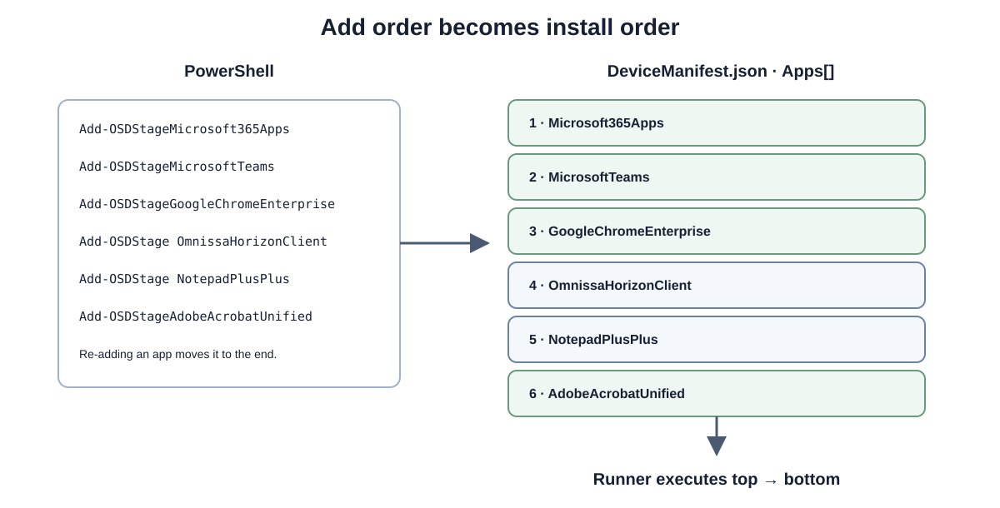

# Runtime and cleanup

[Documentation](README.md) · [Architecture](architecture.md) · [Troubleshooting](faq.md)

OSDApps uses standalone scripts during SetupComplete. The module itself does **not** need to be installed in the deployed Windows installation.



## Runtime content

The public Add cmdlets prepare the selected offline Windows target. Runtime source normally lives under:

```text
<Windows target>\Windows\Temp\OSDApps\
    DeviceManifest.json
    Invoke-OSDAppPreInstall.ps1
    Invoke-OSDAppRunner.ps1
    Restore-OSDAppCacheGeneration.ps1
    Assert-OSDAppTransactionSpace.ps1
    Enter-OSDAppCacheLock.ps1
    Test-OSDAppOfficeCacheCompatibility.ps1
    OSDAppSleepPrevention.ps1
    Packages\
    BuiltIn\
    Work\
```

This is **device staging**, separate from the optional `\OSDApps` USB cache. `DeviceManifest.json` contains one ordered `Apps` array. PreInstall processes its built-ins; Runner processes the full queue in order.

## SetupComplete order

`SetupComplete.cmd` calls the phases in this order:

1. Run `Invoke-OSDAppPreInstall.ps1` to prepare built-in content.
2. Stop on a fatal PreInstall exit code; otherwise run `Invoke-OSDAppRunner.ps1`.
3. Check the Runner exit code and retain the recorded outcome.

The CLI stages these scripts and updates its owned SetupComplete blocks. Do not replace the whole SetupComplete file to change OSDApps settings; other deployment tooling may have its own commands there.

This is a **one-shot execution path**. Windows Setup does not resume `SetupComplete.cmd` after a reboot, and OSDApps does not create a scheduled task, RunOnce value, service or other persistence mechanism to retry it. A retained staging directory is diagnostic/recovery evidence, not a pending automatic run.

### PreInstall

PreInstall runs in **full Windows**, not WinPE. It reads the manifest/runtime settings, detects the optional cache volume and reported network availability, then prepares each built-in's local source.

When online it can acquire/refresh vendor content through the cache, or directly under the local runtime when no cache volume exists. When no network is reported, it can use complete content already staged from the cache. A failed refresh may also fall back to existing staged content.

**An available file is not sufficient by itself.** Supported MSI/EXE files must pass Windows Authenticode and expected-publisher checks before they are used, including the fallback path. An ordinary source/acquisition failure without usable fallback is recorded against that built-in; PreInstall finishes as `CompletedWithErrors` and Runner skips that app while continuing independent queue entries. A publisher/signature failure, invalid manifest or other phase-level safety failure remains fatal and prevents Runner from starting.

The signature scope is deliberately limited: Office `setup.exe`, Teams `teamsbootstrapper.exe`, and Chrome/Firefox/Webex MSI files. It does not cover the Office data tree, Teams MSIX or Adobe's outer ZIP. See the [publisher policy](built-in-apps.md#authenticode-and-publisher-policy-0340).

`NetworkInterface.GetIsNetworkAvailable()` reports interface availability; it is not proof that a vendor endpoint is reachable. The log distinguishes a directly skipped refresh from a failed refresh followed by fallback.

### Runner

Runner reads the ordered queue and installs from **local staging**. Before starting the first installer, it validates every available selected repository archive against its SHA-256. A mismatch aborts the complete queue. It then extracts each repository ZIP and executes `Package/Install.ps1`; it does not synchronize the repository after boot.

For built-ins it invokes the corresponding local installer/provisioning mechanism. Adobe's archive is extracted locally before Adobe Setup runs. Vendor MSI built-ins use Windows Installer with silent arguments. Installer exit codes, timeouts and missing app-local source are isolated to that queue entry; Runner records the error and proceeds to the next independent app. Invalid manifest state and integrity/trust failures stop the queue. Any failed or skipped entry makes the final deployment `Failed` and prevents cleanup.

Installer/provisioning success is not independent evidence of app activation, user sign-in or every interactive feature.

## Runtime configuration

**Set these values in the WinPE staging session before adding apps:**

```powershell
Set-OSDAppConfiguration `
    -CleanupMode OnSuccess `
    -CacheVolumeLabel 'OSDCloud' `
    -LogPath '%ProgramData%\OSDApps\Logs\Runtime.log' `
    -ResultPath '%ProgramData%\OSDApps\Results\Latest.json'
```

Configure a real `CatalogUri` in the same session when staging online repository apps. It is not needed for built-ins-only deployment.

The session's `CleanupMode`, `PreventSleep`, `CacheVolumeLabel`, `LogPath` and `ResultPath` are written into the device manifest by the Add commands. A unique `DeploymentId` is also added when the manifest is first staged. SetupComplete therefore does not depend on the preparation machine's session or on importing the module. Changing session configuration alone does not retroactively rewrite an existing device manifest.

| CleanupMode | Behavior |
| --- | --- |
| `OnSuccess` | Schedule removal of temporary runtime source after a successful complete run. |
| `Never` | Retain staging, payloads and Work for troubleshooting. |

On failure, source is retained automatically.

## Automatic sleep prevention

`PreventSleep` defaults to `true`. PreInstall and Runner each hold a temporary Windows `PowerRequestSystemRequired` request while their phase runs. This covers built-in acquisition, repository/script execution and installer waits. It does not apply to WinPE staging, development-PC cache synchronization or time spent at OOBE.

The request is released in `finally` on success and failure. Windows closes the process-owned handle if the process is forcibly terminated. No power-plan settings, services or scheduled tasks are changed or created. The display can turn off normally. The two phases own separate requests; there is no persistent request between phases or after deployment.

To disable it, set the session configuration **before staging apps**:

```powershell
Set-OSDAppConfiguration -PreventSleep $false
```

Use `-PreventSleep $true` to enable it again. The Add commands copy this Boolean into `DeviceManifest.json` under `Runtime.PreventSleep`. Missing values in older manifests default to `true`; non-Boolean values are rejected. Changing session configuration after staging does not change an existing deployment by itself.

`Runtime.log` records `SleepPreventionStarted`, `SleepPreventionStopped` or `SleepPreventionDisabled` per phase. If registration or release fails, it records `SleepPreventionFailed` or `SleepPreventionReleaseFailed` as a warning; the original deployment outcome and exit code are preserved. Registration failure means protection is unavailable, not that deployment failed.

**Keep AC power connected.** This is protection against automatic idle sleep, including Modern Standby under applicable Windows power policy. It does not prevent explicit Sleep, lid-close or power-button actions, critical-battery shutdown or power loss. On Modern Standby systems on battery power, Windows terminates system/execution requests five minutes after the sleep timeout expires. See [Microsoft PowerSetRequest documentation](https://learn.microsoft.com/en-us/windows/win32/api/winbase/nf-winbase-powersetrequest).

The [isolated development-PC test](testing.md#isolated-sleep-prevention-test) loads this same runtime helper without running SetupComplete or installing apps.

## Machine-readable deployment result

PreInstall writes a phase record, and Runner atomically replaces `Latest.json` as the queue progresses. The final result is outside the staging directory by default and therefore survives `CleanupMode OnSuccess`:

```text
%ProgramData%\OSDApps\Results\Latest.json
```

```powershell
$Result = Get-OSDAppDeploymentResult
$Result.Status
$Result | Select-Object Status, SuccessfulAppCount, FailedAppCount, SkippedAppCount
$Result.Apps | Select-Object Id, Status, FailureType, ExitCode, Version, DurationSeconds, Integrity, CacheUsed, PackageUpdated
```

The top-level status is `Running`, `Succeeded` or `Failed`. The final record includes the deployment ID, timestamps, duration, expected/success/failed/skipped counts, configured cleanup/log paths, the PreInstall phase record and one entry for every selected package. Each result includes `PackageType` (`App` or `Script`; missing package-type metadata defaults to `App`). Status is `Succeeded`, `Failed` or `Skipped`; `Skipped` means OSDApps deliberately did not invoke that package, for example because its PreInstall acquisition failed or a preceding critical safety failure aborted the queue. Runner updates through a temporary file and rename so readers do not observe partially written JSON.

`Integrity` records the check actually performed by Runner. Repository archives report SHA-256 validation; supported built-in publishers are validated in PreInstall and carried as phase context. Acquisition flags come only from the uniquely matching app in this deployment's `PreInstall.json`, never from a previous sync in `CacheInfo.json`. Both reports must have the same non-empty `DeploymentId`; missing or mismatched identities are ignored.

- `PackageUpdated=true` means PreInstall successfully acquired/replaced the primary install content in this run (`Downloaded`). It is not a version-increase test: fetching the same version can still return true.
- `PackageUpdated=false` means the primary content was reused (`CacheReused`, `OfflineCacheUsed`, or `FallbackCacheUsed`). Offline/fallback use does not prove that it is current. Teams may download its bootstrapper separately while reusing the MSIX and reporting false.
- `PackageUpdated=null` means unknown, failed acquisition or not applicable. Missing/non-Boolean fields do not become false. An installer failure after a successful acquisition does not erase the acquisition facts.
- `CacheUsed` retains the PreInstall meaning: a USB cache root was selected for that preparation operation. It is not proof of reuse: a new download may populate that cache, and already staged local content may be reused without a USB cache. The matching per-app Boolean is copied, or null if unavailable. The top-level `PreInstall.CacheUsed` has the same USB-root meaning.

Company Portal, CMTrace Open, bundled Inbox Cleanup and repository/script entries do not participate in this PreInstall acquisition phase; their final `AcquisitionOutcome` is `NotApplicable` and these two flags remain null. Missing or ambiguous acquisition evidence for an eligible built-in reports `Unknown`, with null flags. File identity such as version and architecture may still be read from `CacheInfo.json`. No historical result or cache file is rewritten by this reporting correction.

### Acquisition and installation are separate results

From 0.42.0, `AcquisitionOutcome` describes how PreInstall prepared a built-in's
primary payload during **this deployment**. It is copied to the matching Runner
app result; `Status`, `ExitCode`, `FailureType` and `Error` continue to
report installation or a blocking preparation failure.

| AcquisitionOutcome | Meaning |
| --- | --- |
| `Downloaded` | The acquired primary payload passed the preparation checks and is ready to install. It may be the same version as before. |
| `CacheReused` | Vendor metadata matched the existing primary payload, or an explicit Office build pin matched; applicable preparation checks passed. |
| `OfflineCacheUsed` | No network interface was available; acceptable staged/cache content was used without a refresh attempt. Freshness was not established. |
| `FallbackCacheUsed` | Refresh failed, but acceptable staged content was available. `RefreshFailureType` and `RefreshError` retain the refresh failure. Freshness was not established. |
| `Failed` | PreInstall could not prepare this entry; inspect its preparation error and Runner status. |
| `Unknown` | Runner has no matching acquisition outcome, for example with an older PreInstall result. |
| `NotApplicable` | Repository packages, including scripts, do not use this built-in PreInstall acquisition path. |

Office reports `CacheReused` when configuration and generation checks pass and
its build matches the architecture-specific build advertised by the channel CDN, or an explicit requested build matches.
If acquisition is needed, ODT builds a fresh complete generation and reports
`Downloaded`, even when the resulting version is unchanged. A failed descriptor
request can use acceptable content as `FallbackCacheUsed` with a warning.
Teams can report `CacheReused` for its MSIX while downloading the bootstrapper;
reuse does not mean zero network traffic. These checks do not authenticate or
verify every nested payload file.

The embedded `PreInstall` record adds `FallbackAppCount`,
`OfflineCacheAppCount` and `HasAcquisitionWarnings`. A fallback can
therefore coexist with a final `Status=Succeeded`: all installations succeeded,
but one or more refreshes did not. `OnSuccess` cleanup still follows installation
success, and the persistent result retains the warning after source cleanup.
These are additive fields in result schema `1.0`.

```powershell
$Result = Get-OSDAppDeploymentResult
$Result.PreInstall | Select-Object Status, HasAcquisitionWarnings, FallbackAppCount, OfflineCacheAppCount
$Result.Apps | Select-Object Id, Status, AcquisitionOutcome, CacheDecisionReason, RefreshFailureType, RefreshError, ExitCode, Error
```

`CacheDecisionReason` explains the decision made during this deployment. It is
recorded per built-in in PreInstall, copied into Runner results and included in
the `AppAcquisitionComplete` log event. For example:

| Situation | Explanation |
|---|---|
| Primary payload missing | The selected cache location has no payload to reuse. |
| Cache metadata missing or unreadable | Currency cannot be established from the recorded metadata. |
| Office configuration incompatible | The requested payload profile differs; the reason includes the compatibility checks that failed. |
| Office generation invalid | Generation validation failed, with the original validation message. |
| Office custom source or unrecognized CDN channel | The public CDN check cannot establish currency for that configuration. |
| Office build mismatch | The compatible generation does not match the explicit build pin or CDN-advertised build. |
| HTTP metadata changed | The ETag or last-modified/length comparison differs. This does **not** prove a newer app version. |
| HTTP metadata insufficient | Comparable metadata is unavailable, so currency cannot be established. |
| Release-validated package rejected | The existing 7Zip, Visual Studio Code or prerequisite generation failed current-release validation; the original validation message is retained. |
| Confirmed reuse | The applicable current-build, HTTP or release checks accepted the existing payload. |
| Offline or fallback use | Content passed the applicable fallback checks, but currency was not established. Refresh failures retain their original error. |
| Acquisition failed | The final failure is reported, even if an earlier comparison would have allowed reuse. |

These explanations describe the existing checks; they do not add downloads,
hashing or a new cache policy. Office generation/configuration validation is not
a full validation of every Office payload file. HTTP metadata matching is not
a full payload hash check. Teams reuse refers to the MSIX; its bootstrapper can
still be downloaded separately.

Treat this field as human-readable diagnostic text, not a stable enumeration.
Use `AcquisitionOutcome` for automation. Older results and repository packages
have no built-in cache-decision reason (`null`); no reason is inferred from old
`CacheInfo.json` metadata. A successful acquisition does not prove installation
success: continue checking `Status`, `ExitCode` and `Error`.

Use `AcquisitionOutcome` for current-deployment freshness and fallback decisions.
Legacy `CacheUsed` describes USB/cache context, not proof of reuse or freshness;
`PackageUpdated` is read from stored cache metadata and can describe an earlier
synchronization when fallback is used. These fields are retained for compatibility.
The `AppAcquisitionComplete` log event records the same preparation
outcome, and `PreInstallComplete` includes fallback/offline counts on success.
No retry, extra download or changed fallback acceptance rule is introduced.

Result writing is best effort so an evidence-path problem does not convert an otherwise successful installer run into a failed deployment. A `ResultWriteFailed` warning in `Runtime.log` means the JSON is incomplete or unavailable; use the log as the authoritative fallback. A successful JSON status remains installer/provisioning evidence, not proof of activation, user sign-in or later interactive health.

## Cleanup policy

With `OnSuccess`, Runner writes its final events, starts a cleanup helper and exits only after every selected app succeeded; the helper removes the staging directory and itself. With `Never`, cleanup is skipped. A failed or skipped app also produces `CleanupSkipped` and retains staging regardless of the configured mode.

The USB cache is separate and is not deleted by local source cleanup. The persistent log should be outside the staging directory; the default ProgramData path is retained. A completion line containing `CleanupMode=OnSuccess` identifies the selected policy. Check cleanup events or filesystem state when you need to prove that cleanup itself finished.

## Logging

The default persistent runtime log is:

```text
%ProgramData%\OSDApps\Logs\Runtime.log
```

Module/cache actions with USB use:

```text
<cache volume>:\OSDApps\Logs\Client.log
```

Runtime `LogPath` can be configured. The Viewer discovers known default locations, so custom paths may need to be read separately. Logs are CMTrace-compatible. The runtime rotates the active log and retains numbered `.1`, `.2` and `.3` archives.

| Event | Interpretation |
| --- | --- |
| `CacheVolumeFound` / `CacheVolumeNotFound` | Whether the configured cache volume was found. |
| `DownloadStart` / `DownloadComplete` | Acquisition activity, including size/duration data. |
| `BuiltInCacheRestaged` | Existing USB content was copied into local staging. |
| `BuiltInSignatureVerified` | The specified supported MSI/EXE and expected publisher passed validation. |
| `BuiltInRefreshSkipped` | No network was reported; existing staged built-in content was selected. Recorded as a warning, not an installer failure. |
| `BuiltInRefreshStart` / `BuiltInRefreshComplete` | Refresh/acquisition attempt and successful readiness of content. |
| `BuiltInRefreshFailed` | A refresh failed and the existing local fallback was selected after applicable checks. |
| `AppRefreshFailed` / `RefreshCompletedWithErrors` | One built-in could not be prepared; its installer will be skipped while independent apps continue. |
| `RefreshFailed` | PreInstall encountered a fatal phase/trust failure; Runner is not started. |
| `PreInstallComplete` | The built-in preparation phase completed successfully or with explicitly reported per-app errors. |
| `PackageIntegrityValidated` | A repository package passed the pre-execution integrity gate. |
| `BuiltInInstallComplete` / `PackageInstallComplete` | Individual installer/provisioning outcome. |
| `AppInstallComplete` | Complete processing duration for one queue entry. |
| `AppInstallFailed` | One installer/source failed; independent queue entries continue. |
| `AppInstallSkipped` | The installer was deliberately not invoked because preparation failed. |
| `InstallCompletedWithErrors` | The one-shot queue finished with at least one failed or skipped app. |
| `InstallFailed` | A critical Runner failure aborted the queue; remaining entries are reported as skipped. |
| `InstallComplete` | Runner completed the full queue; check its app count and individual results. |
| `CleanupScheduled` / `CleanupSkipped` | Cleanup was scheduled or intentionally skipped. |

An offline installation is not demonstrated by a short runtime alone. Review `BuiltInRefreshSkipped`, signature checks and final installation outcomes. An online cache hit can also be fast.

### Synchronization versus updated content

`CacheSynchronized=True` means cache synchronization took place, not that a new version was downloaded. Microsoft 365 Apps reports `VersionChanged`; Teams and the HTTP-metadata-based packages report `PackageUpdated`. Read those values alongside the source path and version.

### Downloads and timeouts

Large runtime downloads use streaming HttpClient and a temporary `.download` file before the completed file is moved into place. `DownloadComplete` reports bytes, size, duration and average throughput. Network/download completion is distinct from signature verification of a supported installer.

Office's standalone refresh timeout is 20 minutes by default. Adobe installation defaults to 15 minutes; its runner emits a waiting heartbeat while the installer is running. An Office refresh timeout may still lead to a successful installation from acceptable staged fallback. An installer timeout fails that queue entry and retains staging; see [failure handling](#runner).

To choose a different Adobe installation timeout, set it **when staging in WinPE**:

```powershell
Add-OSDAppAdobeAcrobatUnified -InstallTimeoutMinutes 20
```

## Vendor MSI built-ins

Chrome Enterprise, Firefox Enterprise, Cisco Webex and Zoom Workplace use the `VendorMsi` runtime type. The local MSI is installed through `msiexec.exe /i ... /qn /norestart`, with any validated built-in MSI properties appended.

The generic MSI runner uses a 10-minute default installation timeout, logs waiting heartbeats, accepts exit codes `0` and `3010`, and retains source on failure. Review app-specific options before changing properties; the Viewer does not edit them.

## Timing and failure diagnostics

| Duration field | Scope |
| --- | --- |
| `PreInstallComplete.DurationSeconds` | Built-in preparation phase |
| `BuiltInRefreshComplete.DurationSeconds` | One built-in's acquisition/refresh processing |
| `AppInstallComplete.DurationSeconds` | Complete queue-item processing, including validation/extraction where applicable |
| `InstallComplete.DurationSeconds` | Full Runner phase |

PreInstall failure types include `NetworkUnavailable`, `Timeout`, `CacheOrSourceMissing`, `RemoteAcquisition`, `TrustValidationFailed`, `ManifestInvalid` and `PreInstallError`. Runner types include `HashMismatch`, `ManifestInvalid`, `PreInstallFailed`, `SourceMissing`, `Timeout`, `InstallerFailed`, `AppError`, `AppFailures` and `RuntimeError`. The original message remains alongside the category; use it to diagnose the actual cause. These outcomes never schedule an automatic retry.

The [validation matrix](testing.md) and [performance history](performance.md) distinguish measured phases from image deployment, WinPE staging, boot and OOBE time.
