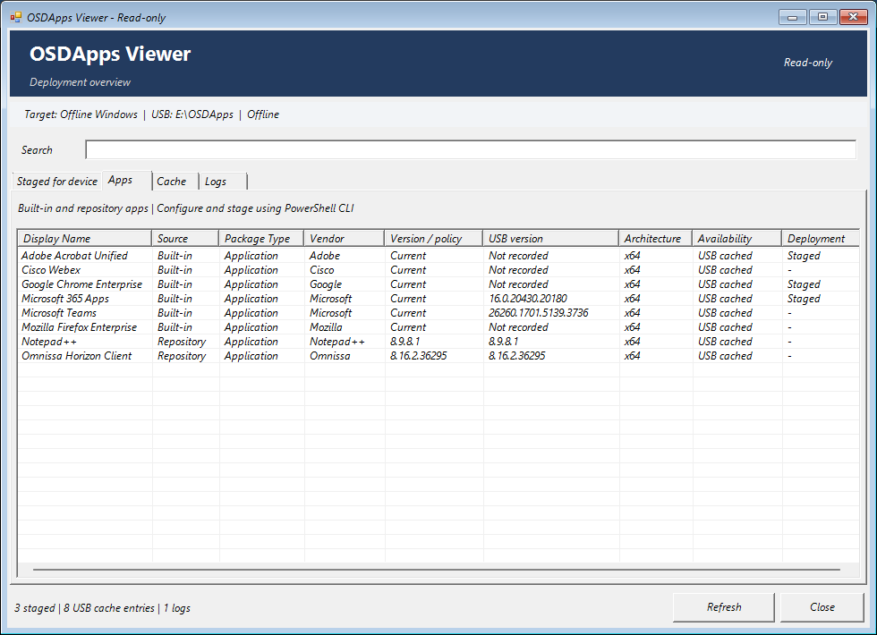
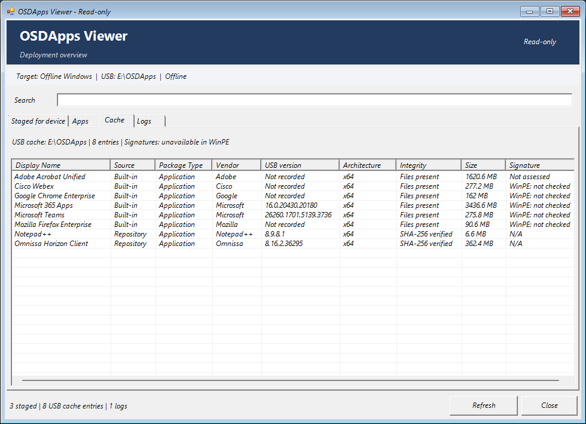

# OSDApps UI

[Documentation](README.md) · [Getting started](getting-started.md) · [Troubleshooting](faq.md)

OSDApps Viewer is the read-only interface opened by `Show-OSDAppUI`. It displays what the CLI has prepared: the device queue and configuration, built-in/repository apps, script packages, USB cache and existing logs. It does not add, remove, configure, download or install applications.

## Selection and configuration preview (unreleased)

The development version extends **the existing `Show-OSDAppUI` command**. PowerShell Gallery 0.43.0 still opens the read-only Viewer described below. Import the module from the reviewed source checkout to try this preview; no new release or exported cmdlet is introduced by this change.

The **Apps** tab opens first. Check built-in applications or repository applications/scripts to create a selection in memory. Highlight a built-in and click **Configure selected...**; configuring an unchecked app does not select it. The configuration dialog has **Apply**, **Cancel** and **Reset defaults**. Defaults and supported choices come from the loaded built-in cmdlet, never from the USB cache. Repository packages retain their package-defined settings.

For example, configure Microsoft 365 Apps with **MonthlyEnterprise**, **x64**, five languages (`nl-nl`, `en-us`, `de-de`, `fr-fr`, `es-es`), **Include Visio** and **Shared Computer Licensing**. Enter languages on separate lines; commas also work. Other supported built-ins expose their own options, including Firefox channel/language, Teams meeting add-in and Webex settings. Webex Outlook integration distinguishes **Vendor default**, **Enabled** and **Disabled**.

An Office **Custom XML path** overrides the generated Office settings. Those controls are disabled while the path is populated. Apply checks that the file exists and is well-formed without editing it; this does not validate Office licensing or ODT's full configuration schema. Clear the path to use the generated settings again.

The lower **Selection preview** lists the desired order and configuration summary. Select a row for the full summary, use **Move up / Move down**, configure again or remove it. Filtering, inventory sorting and Refresh preserve the draft. Unchecking an app retains its settings until the window closes. A removed item is added at the end when selected again.

**Nothing is staged, downloaded, installed or written by these selection controls.** Apply changes only the in-memory preview. Existing manifests, cache and module configuration stay unchanged. Closing the window discards the preview and asks for confirmation when items are selected. There is no staging or export button in this first step.

**Staged for device** remains a separate view of the actual manifest. The preview starts empty; it does not import or edit previously staged settings. Selecting an app already staged starts a new proposed configuration using cmdlet defaults. This separation also avoids presenting cached Office XML as newly chosen settings. Actual staging, dependency resolution and deployment validation will be added in a subsequent step after UI review.

### Manual preview review

On a development PC or in WinPE with the source module loaded, run `Show-OSDAppUI -Offline`. No deployment or reboot is needed.

1. Check Office, Adobe Acrobat Unified and Google Chrome Enterprise.
2. Configure Office as above, apply, and inspect the summary. Reopen it and cancel an edit; the prior values should remain.
3. Move Chrome to the top. Search for Office, clear the search, sort the inventory and Refresh; the selection and desired order should remain.
4. Uncheck and recheck Office; its configuration should remain, with Office appended to the selection.
5. Inspect the existing **Staged for device**, **Cache** and **Logs** tabs. These remain inspection views.
6. Close and confirm discarding the preview. Reopening starts an empty preview.

The existing screenshots below show the released Viewer, not this unreleased preview. Native control tests run in Windows CI; a real WinPE screenshot/usability review is still required before the staging step.

## Released Viewer (0.43.0)

## Where to run it

See the [screenshots below](#screenshots-from-winpe) for a real WinPE session with three staged built-ins and eight cached packages.

| Environment | Target inspected | Notes |
| --- | --- | --- |
| Windows preparation machine | Connected USB cache, plus an existing target if supplied with `-WindowsPath` | Prepare and inspect deployment content. There is no need to install the Viewer on deployed devices. |
| WinPE | Discovered offline Windows installation, or an explicit `-WindowsPath` | Inspect after OSDCloud has applied Windows and the CLI has staged apps. Do not use `-TestMode`. |
| Full Windows with `-TestMode` | Existing `%TEMP%\OSDApps-GUI-Staging-Test` folder | Legacy isolated test-target inspection. The Viewer does not create the folder or stage sample apps. |

Use an STA PowerShell session with Windows Forms available. The WinPE image also needs PowerShell and .NET support. Windows 11 and two x64 WinPE devices were exercised during 0.34.0 validation; those tests do not establish compatibility with every WinPE image or architecture.

## Open the Viewer

**Windows preparation machine, with OSDApps installed:** start Windows PowerShell in STA if needed, then import the module inside that session.

```powershell
powershell.exe -STA -NoProfile
```

In the new PowerShell session:

```powershell
Import-Module OSDApps
Show-OSDAppUI -Offline
```

**WinPE:** use the module import in the [online](../Examples/WinPE-Online.md) or [offline](../Examples/WinPE-Offline.md) staging example, then run:

```powershell
Show-OSDAppUI -Offline
```

To inspect a particular Windows root, supply that root, not its `Windows` subdirectory:

```powershell
# Replace D:\ with the prepared Windows volume you intend to inspect.
Show-OSDAppUI -WindowsPath 'D:\' -Offline
```

For online repository discovery, set your actual `CatalogUri` through `Set-OSDAppConfiguration` in the same session and omit `-Offline`. The repository URL cannot be edited in the Viewer.

## Screenshots from WinPE

These unmodified screenshots show an actual staging session. App versions and Office settings reflect that session, not a required configuration. The examples in this guide can use different channel and language choices.

### Staged queue and selected configuration


Microsoft 365 Apps, Adobe Acrobat Unified and Google Chrome Enterprise are queued for SetupComplete. The detail pane shows the selected Office configuration. This is staging evidence, not an installation result.

### Available apps and repository packages



The Apps tab combines built-ins and repository metadata. Notepad++ and Omnissa Horizon Client are packages supplied by the repository used for this session; they are not bundled with OSDApps. All packages shown here are applications. Script packages appear in the same view with `Package Type: Script` when present.

### Cache availability and integrity



The Cache tab separates recorded versions, file availability, repository hashes and signature status. `Not recorded` means no concrete package version was recorded. `WinPE: not checked` reflects the environment: supported built-in signature and publisher checks run in full Windows sync and PreInstall.

## Header and navigation

The compact context row shows **Target | USB | Offline/Online**. Its tooltip provides fuller target, cache and catalog context. `Offline` describes repository lookup behavior, not the machine's actual network connection.

Search filters displayed rows. Clicking a column header sorts the view; it does not change `DeviceManifest.json` or installation order. Refresh reloads the inventory and applicable checks. The only other actions are selecting a row/log, switching tabs and closing the window.

## Staged for device

This tab reads the selected target's `DeviceManifest.json` and shows the manifest order, Display Name, Source, Package Type, Vendor, version policy, USB version and architecture. The detail pane shows the selected app's actual staged settings, not settings reconstructed from defaults.

The Order column remains the manifest sequence even when the table is sorted differently. The detail pane is populated on initial load when entries are available.

**Staged does not mean installed.** `SetupComplete.cmd: Present` reports file presence, not evidence that SetupComplete or every installer has completed. An empty queue can mean no apps were staged, the wrong target was selected, or successful cleanup removed staging. Use runtime logs to establish the installation outcome.

## Apps

The **Package Type** column shows `Application` or `Script` in **Staged for device**, **Apps** and **Cache**. Search for `Script` to find script packages. The Apps tab contains both types; no separate script queue or script-specific command is needed. Legacy packages without a type are displayed as `Application`.

Apps combines built-in definitions and available repository/cache metadata. Staged apps remain visible even when absent from the current catalog/cache. Source distinguishes built-ins from repository packages; Vendor is displayed only when available from the relevant metadata.

| Column or value | Meaning |
| --- | --- |
| Display Name | Human-readable name; technical Id is a fallback when no name is available. |
| Version / policy: `Current` | Built-in acquisition is vendor-managed. This is not a claim that the cached or installed version is latest. |
| Repository version | Explicit package version from repository metadata. |
| USB version | Recorded or inspected version of the matching cached content, separate from the deployment policy. |
| USB cached | Content is available in the detected USB cache; it is not a statement about installation on the Windows target. |
| Staged | App Id is present in the selected target's manifest. |
| Vendor: `-` | No Vendor value could be resolved; the Viewer does not invent a publisher. |

The CLI can distinguish `Cached` from `CachedOnly`; the Viewer labels both as USB cached. The difference concerns whether a current online catalog match is available, not a different physical cache location.

## Cache

Cache lists entries from `\OSDApps` on the configured cache volume, separately from the Windows target's staging folder. It shows Display Name, Source, Package Type, Vendor, USB version, architecture, integrity, size and signature status. Row tooltips retain the exact signature file, signer and check scope where available.

### Versions

On full Windows, the Viewer requests `Get-OSDAppCache -ResolveVersions` to inspect existing valid content without updating cache metadata. MSI packages can provide ProductVersion; Adobe's ZIP can provide the included patch build through `setup.ini`. Office and Teams use their recorded cache metadata. The Adobe version is a patch build, not necessarily the base MSI version.

WinPE relies on saved metadata rather than the full-Windows MSI inspection path. `Not recorded` means there is no usable specific version to display; it does not by itself mean the package is missing. A cached version is never presented as an independently verified installed version.

### Integrity and signature are different checks

| Status | What was checked |
| --- | --- |
| Integrity: `Files present` | Required built-in files/directories exist. This is not a full cryptographic check. |
| Integrity: `SHA-256 verified` | A repository ZIP matches the hash in its package metadata. |
| Signature: `Signature valid` | The supported MSI/EXE passed Windows Authenticode trust and the expected built-in publisher check. |
| Signature: `Not assessed` | The format is outside this Authenticode inspection path, such as Adobe's outer ZIP. |
| Signature: `N/A` | Repository ZIP signature inspection does not apply; see its separate SHA-256 result. |
| Signature: `Unavailable in WinPE` | OSDApps did not invoke Windows signature verification in WinPE. |
| Signature: `Not checked` | Signature inspection was deliberately skipped or no check result was requested. |

Invalid, untrusted or unexpected-publisher results must not be interpreted as valid content. The CLI's `Valid` property continues to describe required file presence or repository SHA-256 integrity; inspect `SignatureStatus` separately.

### Default signature inspection and network behavior

The Viewer checks supported built-in MSI/EXE signatures by default on full Windows. The public CLI keeps explicit opt-in inspection:

```powershell
Get-OSDAppCache -ResolveVersions -VerifySignatures |
    Select-Object Id, Version, Valid, SignatureStatus, SignatureScope, SignatureSigner
```

Office inspection covers **setup.exe only**; Teams covers **teamsbootstrapper.exe only**. It does not verify the Office data tree or Teams MSIX. Adobe's outer ZIP remains outside the supported Authenticode scope. See the [publisher policy](built-in-apps.md#authenticode-and-publisher-policy-0340).

`-Offline` disables repository lookup, but Windows trust/revocation evaluation may still use the network. To suppress both catalog lookup and signature inspection by the Viewer:

```powershell
Show-OSDAppUI -Offline -SkipSignatureVerification
```

This affects **viewing only**. It does not disable the signer policy enforced by built-in synchronization or SetupComplete, and it does not disconnect network adapters.

## Logs

Logs reads up to 500 recent lines from a selected existing log and presents Timestamp, Level, Component, Event and Message. Select a row to see the full parsed details; long table values may be truncated at smaller window sizes. The row tooltip retains raw log text.

The Viewer discovers known USB/device log locations. A custom runtime `LogPath` may need to be opened separately with PowerShell or a log reader. It does not create a missing log or make a new deployment log before SetupComplete has run.

See [Runtime and cleanup](runtime.md#logging) for paths and event meanings. `PreInstallComplete`, individual exit codes and `InstallComplete` are the installation evidence; the Apps/Staged tabs are not installed-software inventory.

## Troubleshooting

| Symptom | Check |
| --- | --- |
| Viewer cannot open in WinPE | Confirm PowerShell, .NET, Windows Forms and an STA session are available. |
| No repository listed | Configure `CatalogUri` in the same session, or deliberately use the local-only `-Offline` view. |
| No staged apps | Confirm target/manifest, whether staging was performed, and whether OnSuccess cleanup already ran. |
| USB not found | Check the volume label, drive visibility and `CacheVolumeLabel`; do not assume the same drive letter on each machine. |
| Signature trust failed | Inspect status, signer, clock and Windows trust/revocation availability; do not bypass deployment policy merely to make the Viewer green. |
| Refresh is slow | It can re-read files, compute repository hashes, inspect versions and evaluate signatures. |

To capture a Viewer exception without changing deployment state:

```powershell
try { Show-OSDAppUI -Offline -ErrorAction Stop }
catch { $_ | Format-List * -Force; $_.ScriptStackTrace }
```

[Back to documentation](README.md)
